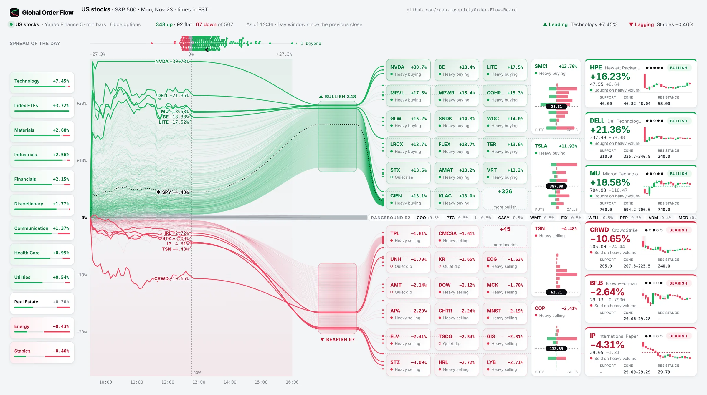
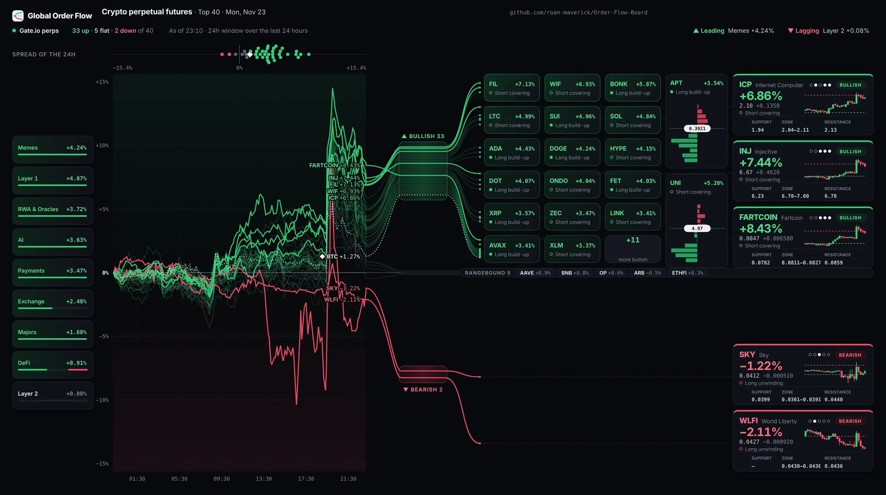
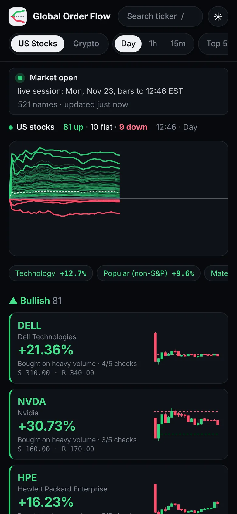
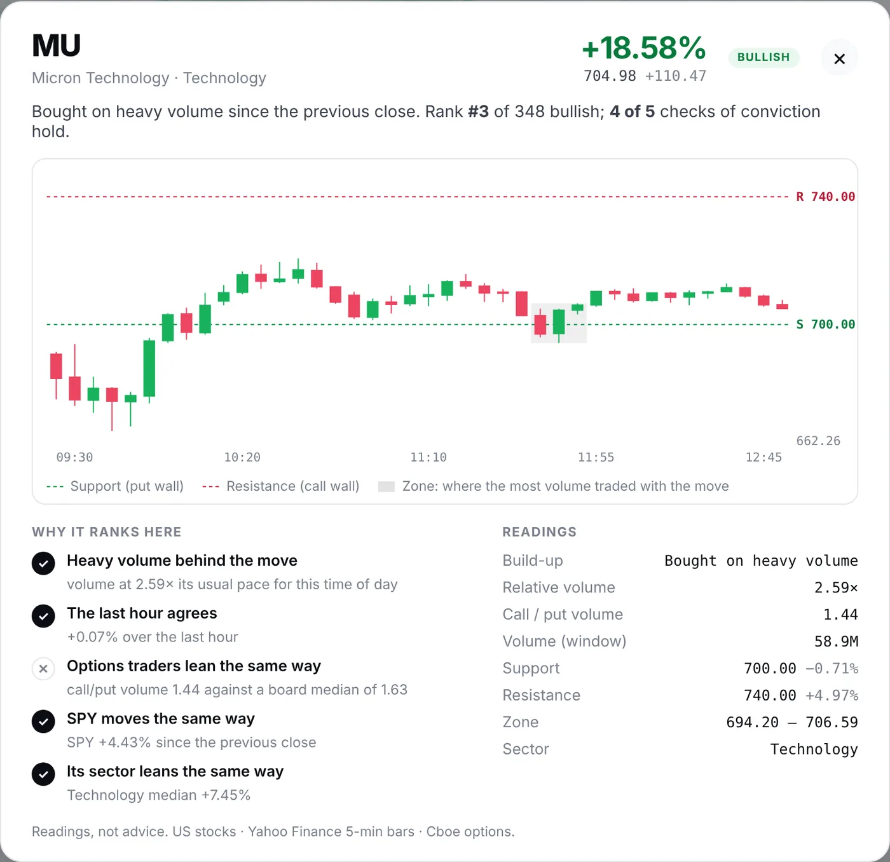

[English](README.md) | **中文**

<div align="center">


# Global Order Flow

### 在一块屏幕上，实时看清整个标普 500 和加密市场的资金流向。

每只股票要么升到零轴上方，要么落到零轴下方，再沿着自己的路径走到一张卡片上。<br>
你可以同时看到整个市场，以及每一只背后有没有真金白银。

**免费 · 开源（MIT）· 在你自己的电脑上运行 · 不需要 API 密钥 · 不用注册**

本仓库是 **Roan Maverick** 原项目的公开副本：[roan-maverick/Order-Flow-Board](https://github.com/roan-maverick/Order-Flow-Board)（npm 包名 `global-order-flow`）。Copyright (c) 2026 Roan Maverick。Allencake 没有创作原作品。见 [NOTICE](NOTICE)。

[](https://github.com/Allencake/order-flow-board/actions/workflows/ci.yml)

[快速开始](#快速开始) · [怎么读这块看板](#怎么读这块看板) · [配合 AI 使用](#配合-ai-使用) · [做自己的 AI 交易系统](#做自己的-ai-交易系统) · [API](#json-api) · [常见问题](#常见问题)

</div>

<br>



<table>
  <tr>
    <td width="66%"></td>
    <td width="34%"></td>
  </tr>
</table>

<sub>截图来自 2026 年 11 月 23 日的真实时段：美股盘中，加密永续来自 Gate.io。界面可以在顶栏切换成中文；这些截图仍是英文界面。</sub>

## 这是什么

一块覆盖两个市场的**实时看板**：

- **美股：** 全部 **503 家标普 500 公司**，外加 SPY、QQQ、DIA、IWM，以及指数外的热门名字（MSTR、TSM、ARM、SOFI…）。可以在**前 50**、**前 100**（今天成交最活跃的）、**标普 500** 和**全部**之间切换。
- **加密货币：** **成交最活跃的永续合约**（BTC、ETH、SOL、XRP、DOGE…），**前 20、40 或 80**，直接从交易所读取，全天 24 小时。

每一只都会显示：

| | 它告诉你什么 |
|---|---|
| **方向** | 这个窗口里是涨、跌还是平（当日、过去 1 小时、过去 15 分钟…） |
| **增减仓** | 这次波动背后有没有真钱？是新开仓或放量，还是只是悄悄漂移？ |
| **5 项确信检查** | 其余画面是否同意：成交量、更短的窗口、期权或主动买卖、大盘、板块 |
| **支撑与阻力** | 来自最大的期权持仓（认沽墙 / 认购墙），或成交最密集的价位 |
| **板块** | 哪些板块领涨、哪些落后，以及每个板块里有多少只在涨、在跌 |

然后把这些**变成数据**交给你：一键复制进任意 AI 对话，接到 **Claude** 上用自然语言提问，或者从你自己的脚本和机器人里读取。

## 快速开始

需要 **Node.js 22 或更新版本**（[在这里下载](https://nodejs.org)，选 “LTS”）。用 `node -v` 确认。

```bash
git clone https://github.com/Allencake/order-flow-board.git
cd order-flow-board
npm install
npm start
```

然后在浏览器打开 **http://localhost:5199**。

- **第一次启动：** 大约 20 秒后看板可用（标普 500 会显示进度条）。之后会马上打开，因为上一时段已经保存在你的电脑上。
- **没有 git？** 在 GitHub 上点绿色的 **Code** → **Download ZIP**，解压，在该文件夹打开终端，然后运行 `npm install` 和 `npm start`。
- **只想看一看？** `npm run demo` 会在**模拟市场**上运行（价格是虚构的，不需要联网）。
- **停掉它：** 在终端按 `Ctrl + C`。

Windows、macOS 和 Linux 都可以。

顶栏主题按钮旁边有 **中文 / EN**。切换立刻生效，不用刷新，选择会记在这个浏览器里。系统语言是中文时，第一次打开默认就是中文；否则默认英文。也可以用 `http://localhost:5199/?lang=zh` 或 `?lang=en`。股票代码保持原样。

## 怎么读这块看板



| 部分 | 它显示什么 |
|---|---|
| **顶栏** | 选择市场（美股 / 加密货币）、时间窗口和列表（前 50 / 前 100 / 标普 500 / 全部）。用搜索框找代码（或按 `/`）。**中文 / EN** 切换界面语言，并记在这个浏览器里。 |
| **状态条** | 美股是否开盘、你正在看哪个时段，以及数据上次更新的时间。周末显示的是上一时段。 |
| **涨跌分布** | 每只标的是一个点，按涨跌幅摆放：一眼看见市场的形状。菱形是基准（股票是 SPY，加密是 BTC）。 |
| **板块**（左侧） | 每个板块的中位涨跌，最强的在上面。下面的细条表示其中多少只在涨（绿）、平（灰）或跌（红）。悬停一个板块，会点亮它的成分。 |
| **图** | 每只标的在窗口内的走势，从 0% 出发。每一侧涨跌最大的五只会加粗并标出名字；虚线是基准。 |
| **通道** | 所有上涨的线挤过绿色通道，所有下跌的线挤过红色通道，再散开到各自的卡片。 |
| **中间条** | 几乎没动的标的（“区间震荡”）停在这里。 |
| **小卡片** | 每只一张，按涨跌幅度排序。颜色越深，波动越大。**实心点**表示背后有新资金；**空心点**表示这是一次安静的波动（仓位在平，或成交很轻）。 |
| **高卡片** | 接下来最强的几只，带有现价附近每个价位的期权持仓（或成交量）。 |
| **大卡片** | 每一侧**最强**的解读：涨跌、增减仓、确信点、支撑、区间、阻力，以及 K 线。 |
| **点任何东西** | 打开完整解读：带支撑和阻力线的 K 线、区间、每一项检查和理由，以及数字。 |

### 增减仓：波动背后有没有真钱？

**加密货币**把价格和**未平仓量**（还有多少期货仓位开着）放在一起看：

| 价格 | 未平仓量 | 增减仓 | 白话 |
|---|---|---|---|
| ↑ | ↑ | **多头增仓** | 新的买方在开仓 |
| ↑ | ↓ | **空头回补** | 价格上涨是因为卖方在平仓 |
| ↓ | ↑ | **空头增仓** | 新的卖方在开仓 |
| ↓ | ↓ | **多头平仓** | 价格下跌是因为买方在离场 |

**美股**没有对应的个股期货，所以看板用**相对成交量**来比：今天的成交量，相对于这只股票通常到这个钟点会有的成交量。

| 涨跌 | 成交量 | 增减仓 |
|---|---|---|
| ↑ | 比平时更重 | **放量买入** |
| ↑ | 比平时更轻 | **缩量上涨** |
| ↓ | 比平时更重 | **放量卖出** |
| ↓ | 比平时更轻 | **缩量下跌** |

### 五项确信检查

每张大卡片上有五个点（实心 = 成立，空心 = 不成立，灰色 = 测不了）：

1. **参与度：** 有新仓开出（加密），或成交量高于平时的节奏（股票）
2. **更短的窗口同意：** 例如过去 1 小时和当日指向同一边
3. **订单流同意：** 主动买方对主动卖方（加密），或认购对认沽的期权成交量（股票）
4. **大盘同意：** SPY 或 BTC 同向
5. **板块同意：** 这只标的所在的板块偏向同一边

**大卡片**给的是“大波动、强参与、检查通过”综合最好的名字，所以涨跌最大的那只不一定拿到大卡片。

### 支撑、阻力和区间

- **期权墙**（成交最活跃的 100 只股票，以及 BTC 和 ETH）：**支撑**是价格下方认沽未平仓量最大的行权价；**阻力**是价格上方认购未平仓量最大的行权价。
- **成交密集区**（其余所有标的）：过去两个时段里成交最多的价位。阻力为空，只是说明价格已经高于最近成交过的所有位置。
- **区间：** 价格顺着这只标的的方向走时，新仓（加密）或成交量（股票）进来最多的那 15 分钟。

## 配合 AI 使用

### 1. 点一下：「复制给 AI」

在看板上按**复制给 AI**。它会复制整块看板的纯文本简报（宽度、每个板块、最强的结构及其价位）。粘贴到 ChatGPT、Claude、Gemini 或任意 AI 对话里，然后提问，例如：

> Which sectors have the strongest buying today, and which names inside them have all five checks holding?

> Compare the strongest bullish and bearish setups. Which have the tightest distance to support or resistance?

> Explain this board to me like I'm new to trading.

简报保持英文，和接口里的文本是同一份，方便模型阅读。更多提问示例在 [`examples/ai-prompts.md`](examples/ai-prompts.md)（英文）。

### 2. 接到 Claude（MCP）

看板自带一个 **MCP 服务器**，这是把工具交给 AI 助手的标准方式。接上之后，你一问，Claude 就能读到实时看板。

**Claude Desktop：** 打开 **Settings → Developer → Edit Config**，加上这段（用你自己文件夹的完整路径）：

```json
{
  "mcpServers": {
    "global-order-flow": {
      "command": "node",
      "args": ["/full/path/to/order-flow-board/server/mcp.mjs"]
    }
  }
}
```

在 Windows 上，路径用双反斜杠：`"C:\\Users\\you\\order-flow-board\\server\\mcp.mjs"`。然后重启 Claude Desktop。

**Claude Code：**

```bash
claude mcp add --transport stdio global-order-flow -- node /full/path/to/order-flow-board/server/mcp.mjs
```

让看板保持运行（`npm start`），然后直接问：

> What is the S&P 500 doing right now? Which sectors lead?
> Find bullish stocks with heavy buying and at least 4 of 5 checks.
> Give me the full reading on NVDA. Where are its put and call walls?
> Which crypto perps show short build-up on the 4h window?

Claude 会拿到四个工具：`get_market_board`、`find_setups`、`get_symbol` 和 `get_status`。任何支持 MCP 的应用都一样（Cursor、Windsurf 等）。

### 3. 终端

```bash
npm run flow                                          # 美股看板简报
npm run flow -- crypto --window 4h
npm run flow -- us --side bullish --min-checks 4 --fresh   # 过滤后的结构
npm run flow -- us --symbol AAPL                      # 完整看一只
```

## 做自己的 AI 交易系统

看板做了难的部分（把数据收集起来并读懂），然后把干净、结构化的解读交给你。下面是一条从“看着”走到“一套系统”的简单路径，一次只走一步。

**第 1 步：先问。** 用上面的**复制给 AI**或 **Claude 连接**。问问这些名字为什么排在这里。在自动化任何东西之前，先知道一份强解读长什么样。

**第 2 步：把规则写下来。** 把你学到的变成计算机能检查的规则，例如：
*“一只股票放量买入、4 项以上检查成立、并且距离支撑在 3% 以内时做多。止损放在支撑稍下方。目标是风险的两倍。”*

**第 3 步：用模拟盘跑这些规则。** 自带的机器人就是这么做的，用的是**假钱**：

```bash
npm run paper-bot              # 美股
npm run paper-bot -- crypto    # 加密
```

每 5 分钟它向看板要最强的结构，开一笔模拟交易（止损在支撑或阻力，目标是风险的 2 倍），在止损、目标或时段结束时平仓，并把每一笔写进 `paper-trades.csv`。规则大约 30 行，在 [`examples/paper-bot.mjs`](examples/paper-bot.mjs)。改一改，再比较。

**第 4 步：度量。** 让它跨过不同的市场日跑上几周（上涨日、下跌日、平淡日）。用 Excel 或 Google 表格打开 `paper-trades.csv`：胜率、平均盈利对平均亏损、最长连亏。只在一种日子里有效的规则，还不算规则。

**第 5 步：让 AI 帮你改进。** 把 CSV 和看板的解读交给 Claude（或任何 AI），问亏损的交易有什么共同点。接上 MCP 之后，它推理时可以自己去看实时看板。

**第 6 步：到这一步，才去想真钱。** 先接券商的**模拟账户**（大多数券商和加密交易所都有，例如 Alpaca、Interactive Brokers、交易所测试网）。加上硬限制：单笔最大风险、单日最大亏损，以及一个急停开关。从小开始。

> **这个项目故意从不成交真实订单。** 它展示的是市场数据和解读，不是投资建议。市场有风险，过去的解读不能预测未来，你为自己做的任何交易负责。

### 用你自己的代码来读

看板上的每个数字都可以从本地 API 拿到，不限语言：

```python
import requests

board = requests.get("http://localhost:5199/api/flow/us",
                     params={"side": "bullish", "minChecks": 4, "fresh": "true", "limit": 10}).json()
for s in board["results"]:
    print(s["symbol"], s["changePct"], s["buildUp"]["label"], s["support"], s["resistance"])
```

```js
const board = await fetch('http://localhost:5199/api/flow/crypto?window=4h').then(r => r.json());
console.log(board.strongest.bullish.map(a => `${a.symbol} ${a.changePct}%`));
```

## JSON API

看板运行时，这些地址开在 `http://localhost:5199`：

| 端点 | 你得到什么 |
|---|---|
| `GET /api/health` | 加载了什么、美股是否开盘、上次刷新时间 |
| `GET /api/flow/us` | 整块看板：宽度、板块、每一只的方向、增减仓、检查、价位 |
| `GET /api/flow/crypto?window=4h&universe=top20` | 加密的同一份数据，带窗口和列表 |
| `GET /api/flow/us?side=bullish&minChecks=4&limit=10` | 过滤后的结构，最强的在前 |
| `GET /api/flow/us?format=text` | 纯文本简报（**复制给 AI** 复制的就是它，英文） |
| `GET /api/flow/us/NVDA` | 完整的一只，带 5 分钟 K 线 |
| `GET /api/market/us` | 看板据以绘制的原始市场数据 |

**过滤参数：** `window`（美股：`day`、`1h`、`15m` · 加密：`24h`、`4h`、`1h`），`universe`（美股：`top50`、`top100`、`sp500`、`all` · 加密：`top20`、`top40`、`top80`），`side`（`bullish`、`bearish`、`rangebound`），`minChecks`（0–5），`buildUp`（例如 `LONG_BUILD,ACCUMULATION`），`fresh=true`（只要背后有新资金的波动），`sector`，`limit`。加上 `&pretty` 得到易读的 JSON。`GET /api` 会列出全部。

## 数据从哪来

| | 来源 | 有多新 |
|---|---|---|
| **标普 500 名单** | [datasets/s-and-p-500-companies](https://github.com/datasets/s-and-p-500-companies) 的公开数据集（一个月会更新几次），并内置一份以便离线使用 | 每次启动读取 |
| **美股价格和成交量** | Yahoo Finance 5 分钟 K 线，常规交易时段 | 开盘期间每 3 分钟（可能晚几分钟） |
| **美股期权墙** | Cboe 延迟期权报价，未来 35 天内到期 | 每只股票大约一天一次（未平仓量只在隔夜变化） |
| **加密货币** | **币安**，币安被挡住时用 **Bybit**，两者都被挡住时用 **Gate.io**（包括美国）。自动选择。 | 每分钟 |
| **BTC 与 ETH 期权墙** | Deribit | 加载时 |

全部由**你自己的电脑**从公开来源抓取，不需要密钥。这些是免费、非官方的来源：做个人看板正好，但不是有授权的实时行情。商用前请查看各提供方的条款。

## 设置

开箱就能用。要改的话，把 `flow.config.example.json` 复制成 `flow.config.json` 再编辑：

| 设置 | 默认 | 作用 |
|---|---|---|
| `port` | `5199` | 地址：http://localhost:5199 |
| `host` | `127.0.0.1` | 只有你的电脑能打开看板。设成 `0.0.0.0` 后，同一网络上的其他设备也能打开 |
| `us.refreshMinutes` | `3` | 开盘期间美股刷新间隔（分钟） |
| `us.popular` | MSTR、TSM、ARM… | 标普 500 之外额外的美股名字（“全部”列表）。可以换成你自己的 |
| `us.optionsTop` | `100` | 为成交最活跃的这么多只股票计算期权墙（期权链很大：SPY 大约 6 MB） |
| `us.optionWalls` | `true` | `false` 会完全跳过期权（只留成交密集区） |
| `crypto.count` | `80` | 加载多少个永续合约 |
| `crypto.exchange` | `auto` | 或固定一个：`binance`、`bybit`、`gate` |

环境变量也可以：`PORT=5200 npm start`，`FLOW_DEMO=1`，`FLOW_US=0`（只看加密），`FLOW_CRYPTO=0`（只看美股）。加密货币列表和板块在 `src/data/universe.ts`。

界面语言不在这个文件里。它记在浏览器的 `localStorage`（键 `gof.lang`），也可以用地址栏的 `?lang=zh` 或 `?lang=en`。

## 全部命令

| 命令 | 作用 |
|---|---|
| `npm start` | 构建并启动带实时数据的看板 |
| `npm run demo` | 在模拟市场上运行（不需要联网） |
| `npm run dev` | 给开发者：改代码时即时刷新 |
| `npm run flow` | 在终端里读看板 |
| `npm run mcp` | 给 AI 应用的 MCP 服务器（通常由应用自己启动） |
| `npm run paper-bot` | 模拟交易示例（假钱） |
| `npm run update:sp500` | 刷新内置的标普 500 名单 |
| `npm test` | 运行测试 |

## 常见问题

**怎么在中文和英文之间切换？** 用顶栏的 **中文 / EN**。看板马上更新，不用刷新，并会记住这个浏览器里的选择。系统语言是中文时，第一次打开就是中文；否则是英文。也可以打开 `http://localhost:5199/?lang=zh` 或 `?lang=en`。股票代码不变。**复制给 AI** 复制的简报仍然是英文，和 `GET /api/flow/...?format=text` 相同。

**它说这是“模拟行情”。** 要么你是用 `npm run demo` 启动的，要么没有实时来源回应。对加密来说，这表示你的网络把三家交易所都挡住了。检查网络或 VPN。状态条会说明原因。

**为什么加密显示的是 Gate.io 而不是币安？** 币安和 Bybit 会拒绝某些国家的连接（包括美国）。看板会自动改用 Gate.io。解读的方式相同。

**美股休市了。我看到的是什么？** 上一个完整时段。状态条上有日期。下次开盘时它会自己切到新时段。

**它是实时的吗？** 接近。加密每分钟更新。美股 K 线每 3 分钟更新，可能比市场晚几分钟。期权数据有延迟，一天变一次。不要用它做抢在一秒之内的交易。

**有些股票没有支撑或阻力。** 只有成交最活跃的 100 只股票有期权墙（想要更多就提高 `us.optionsTop`）。其余用成交密集区，而一只正处在高位的股票，上方还没有成交过的价位。

**“Port 5199 is already in use”。** 另一份已经在运行，或者别的程序占用了这个端口。关掉它，或换一个端口：`PORT=5200 npm start`（Windows PowerShell：`$env:PORT=5200; npm start`）。

**它用多少流量？** 开盘期间，标普 500 大约每 3 分钟 2 MB。期权墙是大头：大约 120 MB，大概每 8 小时一次。想省流量，就降低 `us.optionsTop`，或在 `flow.config.json` 里把 `us.optionWalls` 设为 `false`。

**可以放到服务器上给我的社群用吗？** 可以：有 Node.js 的地方就能跑。把 `host` 设为 `0.0.0.0`。如果广泛分享，请留意数据来源的条款。

**它会帮我下单吗？** 不会。它只读市场并把解读给你。模拟机器人只用假钱。

## 项目结构

```
server/     本地服务：标普 500 引擎、加密引擎、JSON API、MCP 服务器
src/model/  逻辑：方向、增减仓、检查、价位、区间、板块、给 AI 的简报
src/data/   加密行情、模拟市场、币种和板块列表、标普 500 名单
src/ui/     看板、详情面板、手机布局、搜索
src/i18n/   中文 / 英文界面文案
examples/   模拟交易机器人、AI 提问示例
scripts/    终端工具
```

欢迎贡献。见 [CONTRIBUTING.md](CONTRIBUTING.md)（英文）。

## 署名

本仓库中的软件由 Roan Maverick 编写，复制自 [roan-maverick/Order-Flow-Board](https://github.com/roan-maverick/Order-Flow-Board)。这个副本不声称自己是该原作品的作者。

看板的想法（多方在零轴上方、空方在下方、通道通向卡片）和解读方法（增减仓四象限、确认检查，以及 45/35/20 的强度混合）来自 Mr. Chartist 为印度期货期权做的 [Order Flow](https://github.com/MrChartist/order-flow)。上游项目是面向全球市场的独立实现，从零写起，不含 Order Flow 的代码。

## 免责声明

Global Order Flow 展示市场数据和解读，**仅供信息与学习**。它**不是投资建议**，不建议买入或卖出任何东西，也可能出错、延迟或不完整。交易有亏损风险。你为自己的决定负责。

## 许可证

[MIT](LICENSE)：可以免费使用、修改和分享。

Copyright (c) 2026 Roan Maverick。原项目是 [roan-maverick/Order-Flow-Board](https://github.com/roan-maverick/Order-Flow-Board)。这个副本发布在 [Allencake/order-flow-board](https://github.com/Allencake/order-flow-board)。
